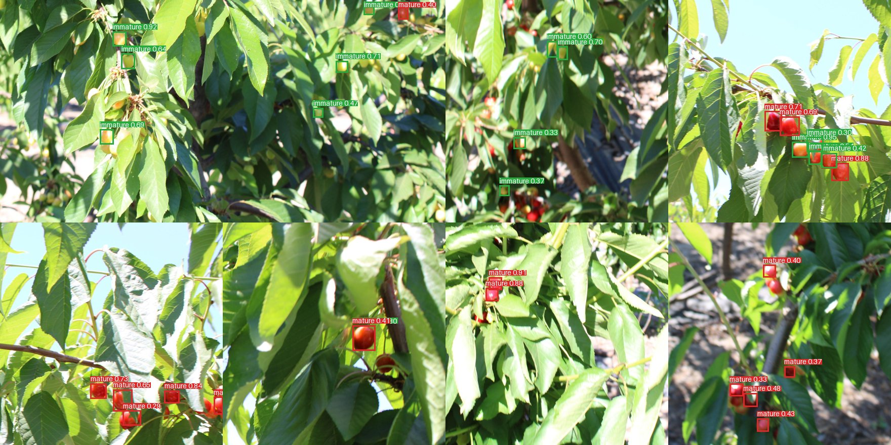

# tiny-yolo

A memory-optimized YOLOv8 inference engine in plain C++17: no third-party code, only the
standard library. It runs ncnn-format models (`.param` / `.bin`) and is built for small
quad-core ARM boards where RAM is the binding constraint.

Starting from a straightforward reference engine that needed **~230 MB** of RAM and **~4–6 s**
per image, this engine runs the same model in **~11–13 MB** at **~25 ms per image** (4 threads),
with detections matching the reference. That is **4.5× less RAM than ncnn** and **13–45× less
than OpenCV DNN, ONNX Runtime and Ultralytics**, at comparable speed.


*The bundled cherry ripeness model on the sample photos: red = mature, green = immature.*

## Compared with other engines

The same cherry YOLOv8n weights in every engine, 4 threads, Linux (arm64, 4 CPUs). Peak RAM
is the whole process; all engines find the same 33 detections on the sample images.

| Engine | Peak RAM | RAM vs. tiny_yolo | Inference / image |
|---|---|---|---|
| **tiny_yolo** (`--weights int8`) | **10.3 MiB** | – | 28.4 ms |
| ncnn (C++, low-memory options) | 46.6 MiB | 4.5× more | 21.5 ms |
| OpenCV DNN (Python) | 135.6 MiB | 13× more | 35.9 ms |
| ONNX Runtime (Python) | 168.1 MiB | 16× more | 29.6 ms |
| Ultralytics / PyTorch (Python) | 464.8 MiB | 45× more | 89.0 ms |

- **RAM:** the next-leanest option, ncnn tuned for memory, still needs 4.5× more. The Python
  stacks need 13–45× more; even without their interpreter and libraries (53–265 MiB with no
  model loaded) they use 80–200 MiB. At ~10 MiB, the detector fits next to other work on a board
  with little RAM, or several instances run side by side.
- **Speed:** faster than OpenCV DNN, ONNX Runtime and Ultralytics on 4 threads, and about
  1.3× behind ncnn.
- **Start-up:** 0.05 s from launch to the first result, against ~1.4–4 s for Ultralytics.

macOS (Apple M3 Max) gives the same picture: 11.2 MiB against 46–457 MiB. Full tables,
1-thread results and the scripts to reproduce them are in [`bench/`](bench/README.md).

## Quick start

The repository includes a sample model (a 2-class cherry ripeness detector) and eight orchard
photos, so you can try it right away:

```sh
make
python3 tools/jpg_to_ppm.py samples/images samples/ppm      # needs Pillow
./tiny_yolo samples/model/model.param samples/model/model.bin samples/ppm/*.ppm --threads 4
```

For a guided walkthrough (build, detect, draw boxes, count ripe cherries, compare memory and
speed across precision modes, and inspect the memory plan), open
[`notebooks/cherry_demo.ipynb`](notebooks/cherry_demo.ipynb). It needs Jupyter and Pillow.
The model is described in [`samples/README.md`](samples/README.md).

## Results

YOLOv8n-sized 2-class model, measured with `tools/evaluate.py` on an Apple M3 Max (the 8
bundled 1328×1328 sample images). Peak RSS is the whole process (one process loads the model
once and processes all images). Per-image time excludes one-time model loading but includes
reading the image, preprocessing and decoding.

| Configuration | Peak RSS | Time / image (4 threads) | Time / image (1 thread) |
|---|---|---|---|
| Reference engine (single-threaded) | 274–315 MiB | – | ~3.9–4.1 s |
| **Default** (fp16/fp32 mixed weights + fp16 activations) | **13.5 MiB** | **26.6 ms** | 80.5 ms |
| `--weights int8` (int8/fp16/fp32 mixed) | **11.1 MiB** | **26.6 ms** | 80.4 ms |
| Exact mode (`--weights fp32 --activations fp32 --input fp32`) | 22.8 MiB | 24.7 ms | – |

Accuracy against the reference engine (18 test images, measured before the speed work below):
default 43/43 detections, worst IoU 0.9987, max score Δ 0.0013; int8 43/43, worst IoU 0.9570,
max score Δ 0.0135; exact mode identical. The speed work changes the default and int8
outputs by at most 0.002 in score (all 33 sample detections kept, IoU ≥ 0.9988), and exact
mode by 3e-6.

The previous version took 40.6 ms (4 threads) and 133.7 ms (1 thread) per image at the
same memory. On Linux (GCC 12, arm64, 4 CPUs) the int8 mode takes 28.4 ms / 86.5 ms per
inference. Linux reports somewhat higher RSS for the same binary (thread stacks and runtime
pages are accounted differently), so expect a few MiB more there.

## Build and run

```sh
make                      # ./tiny_yolo  (static on Linux, dynamic on macOS)
make ARCH=-mcpu=cortex-a72                              # tune for a board
make CXX=aarch64-linux-gnu-g++ ARCH=-mcpu=cortex-a53    # cross-compile
```

```sh
./tiny_yolo model.param model.bin image1.ppm [image2.ppm ...] [--conf C] [--nms N] [--threads T]
```

The model is loaded and planned once; each image is then processed with the same memory.
For every image the engine prints:

```
image <path>
time <seconds>
<class> <score> <x1> <y1> <x2> <y2>
...
```

Input images are binary PPM (P6). They are letterboxed to 640×640.

### Options

| Flag | Meaning |
|---|---|
| `--conf C`, `--nms N` | confidence threshold (default 0.25), NMS IoU threshold (default 0.45) |
| `--threads N` | worker threads (default `min(4, hardware threads)`) |
| `--weights fp16\|int8\|fp32\|stream` | resident weight format (default fp16), applied per layer by size (see [Precision](#precision)). `stream` re-reads weights from the model file every inference (~0 resident, but depends on file I/O) |
| `--fp32-below N` | fp16/int8 modes: layers with fewer than N weights stay fp32 (default 16384; `0` disables) |
| `--int8-min N` | int8 mode: only layers with at least N weights are int8, the rest of the non-fp32 layers fp16 (default 32768) |
| `--activations fp16\|fp32` | storage of large activations (default fp16; compute is always fp32) |
| `--input fp16\|u8\|fp32` | storage of the network input (default fp16) |
| `--stats` | memory statistics on stderr (arena, weights, peak RSS on Linux) |
| `--verbose` | the optimized execution plan: every op, its output dtype and live memory |
| `--no-fuse --no-views --no-concat-inplace --no-inplace --no-stream --no-winograd` | switch individual optimizations off (for ablation) |

## How the memory goes down

The engine is a small compiler: **parse → graph rewrites → dtype selection → memory planning →
one-time allocation → execute**. Nothing is allocated while an image is processed.

### 1. Static memory plan, one arena
At load time the planner computes every tensor's shape and lifetime (first write to last read)
and packs all activations and per-op workspaces into **one arena** with first-fit interval
packing. The arena is allocated once and reused for every image, so the peak is known before
the first frame and the heap never fragments.

### 2. Zero-copy views
`Split`, `Reshape` and outer-axis `Slice` produce views (a shape plus an offset into existing
storage) instead of copies. Views of model constants stay constants.

### 3. Zero-copy concat
Inputs of an outer-axis `Concat` are placed directly in their slice of the concat output, so
producers write there and the concat itself does nothing. The planner only keeps a placement
when it doesn't raise the planned peak (pinning a long-lived input inside a concat output can
keep that output alive longer).

### 4. In-place elementwise ops with a last-use check
Swish, Sigmoid, Softmax and BinaryOp overwrite an input when **nobody reads that storage
later**. The check is on the execution order, not on "has another consumer", so buffers shared
through a `Split` are reused once their other readers have run. Any full-size, non-constant
operand can be the target, so `constant − x` writes into `x`.

### 5. Fusion
Convolution + activation (Swish/Sigmoid/ReLU) and convolution + residual add are executed in the
convolution's epilogue: the intermediate tensor is never written and read back.

### 6. Reduced-precision storage, fp32 compute
Large activations (≥ 65 536 elements) are stored as IEEE fp16. Convolution weights use a
**size-based mixed precision**: big layers in fp16 (or int8 with `--weights int8`), small
layers in fp32. Everything is widened to fp32 inside the kernels; all arithmetic is fp32.
Small tensors and the network output stay fp32.

### 7. Row-streamed convolution chains
Where one convolution feeds only another, the pair runs band by band: the intermediate tensor
lives in a **ring buffer of a few rows** instead of a full feature map. Chains are formed
greedily and kept only when they lower the planned peak. The first convolution's 16×320×320
output is never stored in full.

### 8. Streamed image input
The PPM is read two rows at a time and letterboxed straight into the network input, so the
full decoded image (5.3 MB) never exists.

### 9. Decoding from the output tensor
Detections are decoded directly from the network's output buffer, without a copy.

### What each part is worth
Planned activation arena with one optimization switched off (default otherwise):

| Configuration | Activation arena |
|---|---|
| **Default** | **4.14 MiB** |
| without fusion | 6.25 MiB |
| without fp16 activations | 7.54 MiB |
| without conv-chain streaming | 5.61 MiB |
| without zero-copy concat | 5.27 MiB |
| without views | 4.69 MiB |
| without in-place ops | 4.14 MiB (they only apply after the memory peak) |
| exact fp32, all optimizations off (arena + GEMM only) | 12.50 MiB |
| all tensors kept, no reuse | 197.9 MiB |

Resident weights: 6.06 MiB (default), 3.57 MiB (`--weights int8`), 11.57 MiB (fp32).

## How the speed goes up

None of these raise the planned memory peak:

- **Tiled im2col + GEMM convolution.** Only a small tile of the im2col matrix exists at a time,
  with per-thread scratch bounded by a panel budget. Padding is handled while packing, so no
  padded input copy is made.
- **Pre-packed weights** in `[M/8][K][8]` panels, so the inner loop reads them contiguously.
- **8×8 register-blocked micro-kernel.** Each inner-loop step updates 64 accumulators, reusing
  every loaded input and weight several times. It is written in plain C++ in a form compilers
  auto-vectorize (NEON / SSE / AVX); on ARM a NEON-intrinsics version loads the 8 weights of a
  step with two vector loads and uses lane-indexed FMAs.
- **Winograd F(2×2, 3×3)** for 3×3 stride-1 convolutions (65 % of the model's multiply-adds):
  16 multiplies per 2×2 output tile instead of 36, as 16 small GEMMs on the same micro-kernel.
  The transformed weights are built per inference in the scratch space that already holds the
  decoded fp16/int8 weights, so resident memory doesn't change. The extra scratch is planned
  like everything else: a layer only uses Winograd if the arena doesn't grow
  (`pass_winograd`), so the deep, low-resolution layers stay on im2col.
- **Vectorized epilogue.** Bias and activation run on a whole 8×8 block at once, and results
  are stored with contiguous fp16 conversions.
- **Block fp16 conversion.** Converting to and from fp16 uses the hardware instructions where the
  compiler exposes them (AArch64 NEON, x86 F16C) and the portable bit-twiddling otherwise.
- **Vectorized small ops.** Softmax works on blocks of consecutive positions, nearest upsampling
  copies stored values (and whole duplicated rows), and max pooling is separable.
- **Larger chain bands where they are free.** Each streamed chain's ring budget is doubled while
  the planned arena stays the same (`pass_chain_rings`), so each band gives the thread pool
  more work items.
- **Persistent thread pool** built on `std::thread`, splitting output tiles across workers.

The Makefile adds `-fno-trapping-math`: without it, GCC leaves some activation loops scalar.
The flag doesn't change results.

## Precision

### Size-based mixed precision for weights

Most of the model's weights sit in a few large layers, while the small layers (the stem, the
early high-resolution convolutions, the head outputs and the DFL projection) hold very little
memory but are the most sensitive to rounding. So the weight format is chosen per layer by
size:

| Layer size (weights) | Layers | Share of weights | Default (`fp16`) | `--weights int8` |
|---|---|---|---|---|
| < 16 384 | 23 | 3.7 % | fp32 | fp32 |
| 16 384 – 32 767 | 5 | 3.6 % | fp16 | fp16 |
| ≥ 32 768 | 36 | 92.7 % | fp16 | int8 (symmetric, one scale per output channel and 64-weight group) |

Keeping the small layers in fp32 costs 0.22 MiB and cuts the largest score change of the
default mode from 0.0085 to 0.0013. In int8 mode it cuts the largest score change from 0.037
(int8 everywhere except tiny layers) to 0.0135, for 0.4 MiB. The thresholds are options (`--fp32-below`,
`--int8-min`), so other models can be tuned.

| Mode | Resident weights | Detections vs. reference (18 images) |
|---|---|---|
| default (fp16 + fp32 small layers) | 6.06 MiB | 43/43, worst IoU 0.9987, score Δ ≤ 0.0013 |
| `--weights int8` (int8 + fp16 + fp32) | 3.57 MiB | 43/43, worst IoU 0.9570, score Δ ≤ 0.0135 |
| `--weights int8 --fp32-below 0 --int8-min 4096` (int8 everywhere except tiny layers) | 3.17 MiB | 43/43, worst IoU 0.9866, score Δ ≤ 0.037 |
| exact (`--weights fp32 --activations fp32 --input fp32`) | 11.57 MiB | identical to the reference |

Raising `--int8-min` trades memory for accuracy. At 131 072, only the largest layers are int8
(4.75 MiB): worst IoU 0.9986, score Δ ≤ 0.0048. The thresholds interact with borderline
detections, though: at 65 536 one detection close to the confidence threshold dropped out. So
re-check accuracy on your own data whenever you change them.

## Code map

| File | Contents |
|---|---|
| `src/app.cpp` | CLI, per-image loop, YOLO decoding + NMS |
| `src/graph.*` | model loading, graph passes (fusion, views, dtypes, concat placement, in-place, conv chains), planning, execution |
| `src/memory_planner.*` | lifetime-interval packing into the arena |
| `src/conv.*` | weight packing (fp32/fp16/int8 per layer), tiled im2col, register-blocked GEMM, fused epilogue |
| `src/layer.hpp` | layer interface and the size-based weight-precision policy |
| `src/conv_chain.*` | row-streamed convolution chains with ring buffers |
| `src/layers.*` | the other operators (pooling, interp, concat, slice, reshape, permute, softmax, binary ops, ...) |
| `src/image.*` | streaming PPM reader + letterbox |
| `src/dtype.hpp`, `src/tensor.hpp` | storage types, fp16 conversion, tensor views |
| `src/thread_pool.*` | persistent worker pool |
| `tools/evaluate.py` | peak RSS, per-image time and detection comparison against a reference engine |
| `tools/jpg_to_ppm.py` | converts JPG/PNG images to PPM (Pillow) |
| `samples/` | sample cherry ripeness model (`model/`) and orchard photos (`images/`) |
| `notebooks/cherry_demo.ipynb` | end-to-end walkthrough on the samples |

## Evaluating

```sh
python3 tools/evaluate.py --engine ./tiny_yolo --model path/to/weights --images path/to/ppm_images \
    [--reference path/to/reference_engine] [--threads 4] [--flags "--weights int8"]
```

For example, on the bundled samples:

```sh
python3 tools/evaluate.py --engine ./tiny_yolo --model samples/model --images samples/ppm
```

The Results table above was measured on a larger set of 18 photos against the original reference
engine. That engine isn't part of this repository.

## Supported operators and limits

Input, Convolution (any kernel, stride, dilation and padding, with fused ReLU/LeakyReLU/Sigmoid/Swish),
Swish, Sigmoid, ReLU, Pooling (max/average, including global), Interp (nearest), Concat, Slice, Split, Reshape, Permute,
Softmax, BinaryOp (with broadcast) and MemoryData. All optimizations are selected from the
graph's structure and shapes, not from layer names.

The decoder in `app.cpp` assumes a YOLOv8-style output (`[4 + classes, anchors]`) and the two
class names of the bundled model. Depthwise/grouped convolution, deconvolution and bilinear
resize are not implemented.
